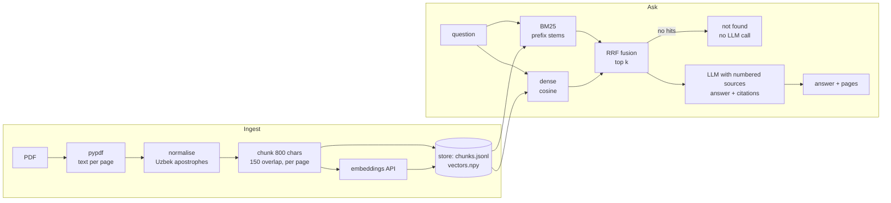

# PDF RAG Assistant

[](https://github.com/ilhomjonshoyimov10-cyber/pdf-rag-assistant/actions/workflows/ci.yml)


Upload PDFs, ask questions, get answers that **cite the exact page** they came from.
Retrieval is hybrid: BM25 for exact words and numbers, embeddings for meaning, merged with
Reciprocal Rank Fusion. The retrieval step is measured on an evaluation set, and Uzbek text
gets special handling (apostrophe normalisation and suffix-aware stemming).

> 🇺🇿 **O'zbekcha:** PDF hujjatlarni yuklang va savol bering. Tizim javobni faqat hujjatdan oladi
> va qaysi faylning qaysi betidan olinganini ko'rsatadi. Qidiruv o'zbek tiliga moslangan:
> `oʻ / o‘ / o'` belgilari bir xil hisoblanadi, qo'shimchalar (`ta'tilni`, `ta'tilga`) bitta so'zga
> keltiriladi. API kalitisiz ham ishlaydi.

## Features

- **Page-level citations:** chunks never cross a page boundary, so every `[n]` in an answer points to a file and page.
- **Hybrid retrieval:** BM25 (implemented from scratch) plus dense vectors, fused with RRF.
- **Grounded answers:** the model may use only the numbered sources. A question with no matching passage is answered "not found" **without calling the LLM** at all.
- **Works without an API key:** BM25 retrieval plus extractive answers (the most relevant passages), so the demo runs anywhere.
- **Uzbek-aware search:** five apostrophe variants are normalised, and fixed-prefix stemming handles agglutinative suffixes.
- **Persistent index** (JSON + JSONL + NumPy) with atomic writes. Content-hash IDs prevent duplicates. The collection is re-embedded automatically when you change the embedding model.
- **Web UI** with drag-and-drop upload and clickable citations, plus a REST API with OpenAPI docs.

## Architecture



## Retrieval evaluation

`eval/questions.jsonl` has 22 questions about the sample document, each with the page that answers it.
The questions are paraphrased, as a real user would ask them (for example "Maosh qaysi kunlari beriladi?"
while the document says "Ish haqi ... to'lanadi").

```bash
python eval/run_eval.py              # BM25 variants, no key needed
python eval/run_eval.py --embeddings # adds dense and hybrid rows (needs LLM_API_KEY)
```

Measured BM25 results (sample PDF: 6 pages, 7 chunks):

| Configuration | hit@1 | hit@3 | MRR |
|---|---|---|---|
| BM25, whole words | 0.68 | 0.73 | 0.72 |
| **BM25, prefix-5 stems (default)** | **0.86** | **0.95** | **0.90** |
| BM25, prefix-6 stems | 0.91 | 0.95 | 0.93 |

Truncating words to their first 5 characters raised top-1 accuracy from 68% to 86%, because Uzbek
attaches suffixes to the stem (`noutbukim`, `yo'qolib`, `kechiksam`). Prefix-5 is the default because
it is the standard fixed-prefix baseline from Turkish retrieval research. Prefix-6 scored slightly
higher here, but choosing by this small set would be fitting to the test.

The remaining misses are synonyms, which no stemmer can fix (`maosh` and `ish haqi` both mean salary).
That is the job of the dense retriever in hybrid mode. A test in CI fails if default BM25 quality
falls below hit@1 0.85 or hit@3 0.90.

Caveats: the set is small and was written by the author for a single fictional document, so these
numbers show the method works and is measured, not general accuracy. Dense and hybrid rows are not
reported because they depend on the embedding model you configure.

## Quick start

```bash
cp .env.example .env          # optional: add LLM_API_KEY for hybrid search and generated answers
docker compose up -d --build
open http://localhost:8000    # the sample PDF is indexed on first start
```

Local:

```bash
python -m venv .venv && source .venv/bin/activate   # Windows: .venv\Scripts\activate
pip install -e ".[dev]"
uvicorn rag.api:app --reload
```

| Mode | Retrieval | Answer |
|---|---|---|
| No key | BM25 | most relevant passages with pages |
| Key + `EMBEDDING_MODEL` | BM25 + dense (RRF) | LLM answer with `[n]` citations |
| Key, `EMBEDDING_MODEL=` empty (e.g. Groq) | BM25 | LLM answer with `[n]` citations |

## API

| Method | Path | Description |
|---|---|---|
| `POST` | `/api/documents` | Upload a PDF (multipart `file`) |
| `GET` | `/api/documents` | List indexed documents |
| `DELETE` | `/api/documents/{id}` | Remove a document and its chunks |
| `POST` | `/api/ask` | `{"question": "..."}` → answer, mode, sources (file, page, text, score, cited) |
| `GET` | `/health` | Counts and active retrieval / generation modes |
| `GET` | `/docs` | OpenAPI documentation |

```bash
curl -F "file=@contract.pdf" localhost:8000/api/documents
curl -X POST localhost:8000/api/ask -H "Content-Type: application/json" \
     -d '{"question": "Yillik ta'"'"'til necha kun?"}'
```

## Tests

```bash
pytest -v
```

37 tests, no network or key needed: normalisation and stemming, PDF parsing and chunk boundaries,
BM25 ranking, RRF fusion arithmetic, store persistence and vector alignment, re-embedding on model
change, the "not found" path, every API endpoint and error code (413, 415, 422, 502), the real
OpenAI-compatible embedding and chat adapters against a mock server, and the retrieval-quality
regression check. CI also runs the evaluation and builds and smoke-tests the Docker image.

## Project structure

```
rag/
  text.py         normalisation, tokenisation, prefix stemming
  documents.py    PDF loading, page-aware chunking
  bm25.py         Okapi BM25
  embeddings.py   OpenAI-compatible embeddings
  store.py        persistent chunks + vectors
  retriever.py    hybrid retrieval with RRF
  generator.py    grounded prompt, citations
  pipeline.py     ingest / ask orchestration
  api.py          FastAPI app
  static/         web UI
eval/             questions + evaluation script
samples/          demo PDF (fictional company rules)
scripts/          generator for the demo PDF
tests/
```

## Limitations

- Scanned PDFs (images) have no text layer and need OCR first; they are rejected with a clear message.
- The NumPy store and in-memory BM25 suit thousands of chunks, not millions. Past that, swap `DocumentStore` for pgvector, Qdrant or FAISS.
- Tables and multi-column layouts are extracted as plain text, so their structure is lost.
- `MIN_SIMILARITY` depends on the embedding model and should be tuned with `eval/run_eval.py --embeddings`.

## License

[MIT](LICENSE) © 2026 Ilhomjon Shoyimov. The sample document describes a fictional company.
